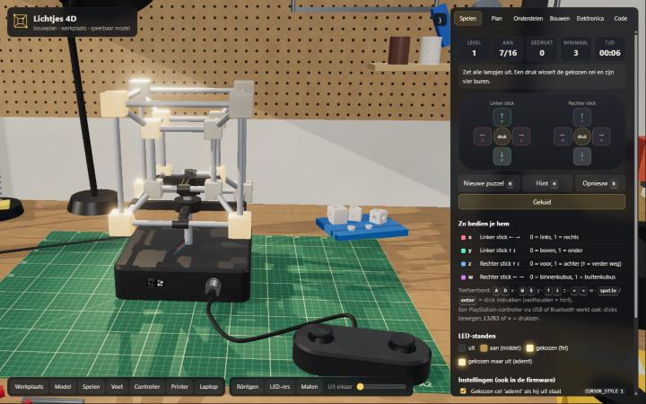
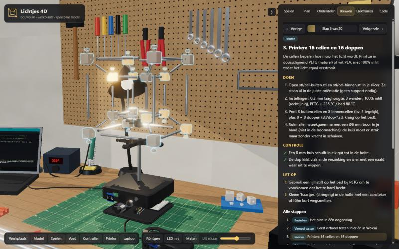
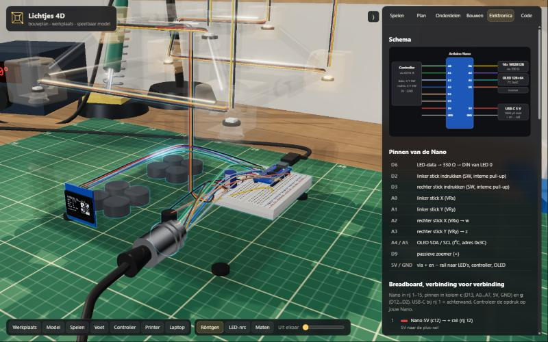
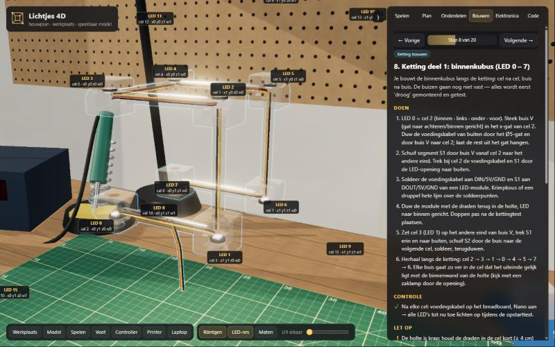
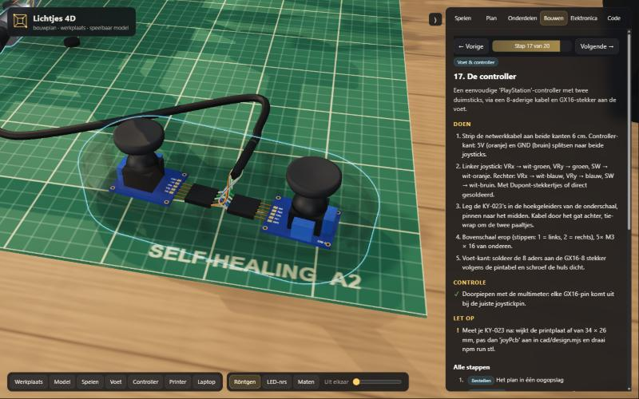

# Lichtjes 4D — het model

Een **echte, speelbare** versie van de 2×2×2×2 *Lichtjes*-puzzel (Lights Out) uit de [4d-puzzels app](https://4d-puzzels.vercel.app): zestien lichtgevende blokjes op de hoekpunten van een binnen- en een buitenkubus — precies de tesseract-weergave — op één staaf boven een voet met een Arduino. Met twee PlayStation-achtige duimsticks kies je een cel; indrukken = drukken.

Dit project bevat **alles** om hem te bouwen met een Arduino, een 3D-printer en code, samengebracht in een **3D-werkplaats** waarin je het model kunt bekijken, uit elkaar halen, stap voor stap opbouwen én spelen.



## Openen

**Dubbelklik `index.html`** (Edge/Chrome). Er is geen server of internet nodig: alles zit in `app/`.

| Tabblad | Wat je ziet |
| --- | --- |
| **Spelen** | Het model leeft: zelfde spelregels, drempels en LED-standen als de Arduino-code. Toetsenbord, knoppen op het scherm of een echte PlayStation-controller (USB/Bluetooth). |
| **Plan** | Afmetingen, kosten, printtijd, de 8 fasen en hoe 4D in het object zit. |
| **Onderdelen** | 11 printbare onderdelen (klik = oplichten in 3D + STL downloaden), inkooplijst met prijzen, zaagplan, draadlengtes, gereedschap. |
| **Bouwen** | 20 bouwstappen. De 3D-scène bouwt mee: alleen wat er al staat is zichtbaar, het nieuwe deel vliegt in en licht op. |
| **Elektronica** | Schema, breadboard verbinding voor verbinding, GX16-pintabel, LED-ketting, stroombudget — met röntgenweergave. |
| **Code** | De firmware met uitleg, uploaden met de Arduino IDE en testen in Wokwi. |






## Het ontwerp in het kort

- **Tesseract**: buitenkubus 160 mm, binnenkubus 84 mm hart-op-hart (verhouding ≈ 1,9 zoals de perspectiefprojectie in de app). 32 ribben van aluminium buis 8 × 1 mm: 12 × 140, 12 × 69 en 8 × 43,3 mm.
- **Cellen**: doorschijnend geprinte blokjes (30 en 24 mm) met een holte voor een WS2812B-LED. De insteekgaten lopen door tot in de holte, zodat je een buis tussen twee vaste cellen kunt schuiven.
- **LED-ketting**: de 16 LED's volgen een Gray-code — elke stap is precies één ribbe — dus de draad loopt altijd door een buis. 15 buizen dragen draad, 17 zijn leeg.
- **Staaf en kruizen**: een 12 mm staaf; twee geprinte kruizen klikken met C-klemmen om de onderste ribben van elke kubus. De staaf valt met een sleuf over een rib in de voet (draait niet, wel afneembaar).
- **Voet**: Arduino Nano op een half breadboard, OLED-schermpje (level, drukken, tijd, kaartje van alle 16 cellen), zoemer, GX16-8 aansluiting voor de controller, USB-C voor stroom én programmeren.
- **Controller**: twee KY-023 joysticks. Links ← → = x, ↑ ↓ = y. Rechts ↑ ↓ = z, ← → = w (binnen/buiten). Kort drukken = drukken, 0,8 s = hint, beide 1,5 s = nieuwe puzzel.
- **LED's**: uit = uit, aan = middel, gekozen = fel (ademt als de gekozen cel uit staat, zodat je zijn stand blijft zien).

## Mappen

| Map | Inhoud |
| --- | --- |
| `index.html`, `app/` | De 3D-werkplaats (gebundeld, werkt offline) |
| `stl/` | 11 printklare STL's, al in printoriëntatie |
| `firmware/lichtjes4d/` | Arduino-code (getest: compileert voor de Nano, 82% flash) |
| `wokwi/` | Wokwi-simulatie met de échte firmware (`sketch.ino`, `diagram.json`, `libraries.txt`) |
| `docs/BOUWHANDLEIDING.md` | De volledige handleiding als tekst, om te printen |
| `cad/` | Parametrisch ontwerp: `design.mjs` (alle maten) en `parts.mjs` (CSG met manifold-3d) |
| `web/src/` | Broncode van de werkplaats (three.js) en de spelsimulatie |
| `scripts/` | Bouwscripts en tests |

## Zelf aanpassen

Alle maten staan op één plek: [`cad/design.mjs`](cad/design.mjs). Daarna:

```
npm install
npm run build   # STL's + Wokwi + handleiding + 3D-werkplaats
npm test        # spellogica en maten controleren
```

Wijkt je joystickmodule af van 34 × 26 mm? Pas `joyPcb` aan en draai `npm run build`: de controller-STL's én de 3D-weergave passen zich aan.

## Waarom elke puzzel oplosbaar is

Op het 2×2×2×2-rooster is een buur 'één bit omgedraaid'. Over GF(2) geldt voor de drukmatrix M = I + A dat M² = I + A² = I (elk paar cellen op afstand 2 heeft precies twee gemeenschappelijke buren). M is dus zijn eigen inverse: elke stand is oplosbaar, de oplossing is uniek, en de firmware berekent de hint in één regel. `npm test` controleert dit voor alle 65 536 standen.
